# CSE201 ATM Term Project — Final Report

**Team:** Rabia (Person A), Altair (Person B), Amina (Person C), Alan (Person D)  
**Repository:** `oop_teamproject_amina_so_creative_teamname`

---

## 1. Instructions to Run

### Requirements
- C++17 compiler (`g++` 7+, `clang++` 5+, or Visual Studio 2019+)
- Run the executable from the project root directory so `data/initial_conditions.txt` is found.

### Build and Run

#### g++ / MinGW / Linux / macOS
```bash
make                 # builds ./atm
make run             # runs ./atm data/initial_conditions.txt
make test-bank       # runs bank-side unit tests
```

Without `make`:
```bash
g++ -std=c++17 -O2 -o atm src/*.cpp
./atm data/initial_conditions.txt
```

#### CMake
```bash
mkdir build && cd build && cmake .. && cmake --build .
./atm ../data/initial_conditions.txt
```

#### Visual Studio (Windows)
Open **x64 Native Tools Command Prompt for VS** in the project folder:
```cmd
mkdir build
cl /std:c++17 /EHsc /utf-8 /Fobuild\ /Fe:build\atm.exe src\*.cpp
build\atm.exe data\initial_conditions.txt
```
`/utf-8` is required because Korean messages are stored in UTF-8. If Korean characters look garbled in the Windows console, run `chcp 65001` before starting the program.

### Usage
1. On startup, the program loads all banks, accounts, ATMs, and optional admin cards from the input file passed as `argv[1]` (defaults to `data/initial_conditions.txt`).
2. Select an ATM from the list (`0` exits).
3. Insert a card by entering its card number (e.g. `1111-1111-1111` for Chris, `2222-2222-2222` for Andor, or `0000` for the Admin card).
4. On bilingual ATMs, choose English (`1`) or Korean (`2`).
5. Enter the password and choose Deposit, Withdrawal, Transfer, or Cancel.
6. Type `/` at any input prompt to print a live snapshot of all ATM cash inventories and account balances.

Restart the program before each test case so the initial state is identical.

### Initial Condition File Format
```text
B A N                      number of banks, accounts, ATMs
<bank name>                x B
<bank>                     \
<user name>                 |
<account number>            |  x A   (12 digits, dashes allowed)
<funds>                     |        ("4000" or "4,000")
<card number>               |        (unique, one card = one account)
<password>                 /
<primary bank>             \
<serial number>             |  x N   (6 digits, unique)
Single | Multi              |
Unilingual | Bilingual      |
<50k> <10k> <5k> <1k>      /         (bill counts)
Admin <card number>        optional, any number of lines
```
Blank lines and `#` comment lines are ignored. If no `Admin` line is present, `0000` is registered as the default admin card.

---

## 2. System Overview & Module Ownership

| Module | Owner | Source Files | Summary |
| --- | --- | --- | --- |
| Bank, Account, Card, Loader & Snapshot | Rabia (Person A) | `Bank.*`, `Account.*`, `Card.*`, `SystemLoader.*`, `Snapshot.*`, `main.cpp` | Stores banks/accounts, verifies cards and passwords, loads initial conditions, handles `/` snapshots, runs outer ATM menu |
| ATM, CashInventory, Session & ConsoleUI | Altair (Person B) | `Constants.h`, `CashInventory.*`, `ATM.*`, `SingleBankATM.*`, `MultiBankATM.*`, `ConsoleUI.*`, `Session.*` | ATM polymorphism (single vs multi bank), greedy bill dispensing, safe console I/O with `/` hook, full session workflow |
| Transactions, Fees, Deposit & Withdrawal | Amina (Person C) | `Transaction.*`, `FeePolicy.*`, `DepositTransaction.*`, `WithdrawalTransaction.*` | Abstract transaction base class with unique IDs, fee rules, cash/check deposits, withdrawals with session/amount limits |
| Transfers, History, Admin, Messages & Exceptions | Alan (Person D) | `Exceptions.h`, `Messages.*`, `CashTransferTransaction.*`, `AccountTransferTransaction.*`, `TransactionHistory.*`, `AdminMenu.*` | Custom exception hierarchy, English/Korean text table, cash & account transfers, session-grouped history & file export, admin menu |

---

## 3. UML Class Diagram

*(From `docs/class_diagram.md`)*

```mermaid
classDiagram
    %% Bank & Account hierarchy (Person A)
    class Bank {
        -string name
        -vector~Account*~ accounts
        +getName() string
        +openAccount(...) Account&
        +verifyCard(cardNumber) bool
        +verifyPassword(cardNumber, pw) bool
        +getAccountByCard(cardNumber) Account*
        +deposit(acc, amount) void
        +withdraw(acc, amount) void
        +findAccount(accountNumber)$ Account*
        +findAccountByCard(cardNumber)$ Account*
        +findBank(name)$ Bank*
        +transfer(src, dst, amount, fee)$ void
        +isAdminCard(cardNumber)$ bool
    }

    class Account {
        -string bankName
        -string ownerName
        -string accountNumber
        -long long balance
        -string cardNumber
        -string password
        -vector~string~ history
        +getBankName() string
        +getOwnerName() string
        +getAccountNumber() string
        +getBalance() long long
        +checkPassword(pw) bool
        +canWithdraw(amount) bool
        +deposit(amount) void
        +withdraw(amount) void
        +addHistory(line) void
    }

    class Card {
        -string cardNumber
        -string bankName
        +getCardNumber() string
        +getBankName() string
        +isAdmin() bool
    }

    class AdminCard {
        +isAdmin() bool
    }

    class SystemLoader {
        +load(path, banks, atms)$ void
    }

    class Snapshot {
        +setATMs(atmList)$ void
        +print()$ void
    }

    %% ATM & Session core (Person B)
    class BillCount {
        +int count50000
        +int count10000
        +int count5000
        +int count1000
        +get(denom) int
        +set(denom, count) void
        +totalBills() int
        +total() long long
    }

    class CashInventory {
        -map~int, int~ bills
        +addBills(added) void
        +removeBills(removed) bool
        +getCount(denom) int
        +getTotalCash() long long
        +canDispense(amount) bool
        +tryDispense(amount, out) bool
        +dispense(amount) BillCount
    }

    class ATM {
        <<abstract>>
        #string serialNumber
        #string primaryBankName
        #LanguageMode languageMode
        #Language currentLanguage
        #CashInventory inventory
        +isCardValid(card)* bool
        +getType()* string
        +getSerialNumber() string
        +getPrimaryBankName() string
        +isPrimaryBank(bankName) bool
        +getLanguage() Language
        +setLanguage(lang) void
        +getInventory() CashInventory&
        +addCash(bills) void
        +dispenseCash(amount) BillCount
    }

    class SingleBankATM {
        +isCardValid(card) bool
        +getType() string
    }

    class MultiBankATM {
        +isCardValid(card) bool
        +getType() string
    }

    class Session {
        -ATM& atm
        -bool active
        -bool authorized
        -int wrongPasswordAttempts
        -int withdrawalCount
        -vector~shared_ptr~Transaction~~ completedTransactions
        +run(card, issuingBank) void
        +canWithdraw() bool
        +recordWithdrawal() void
        +printSummary() void
        +endSession() void
    }

    class ConsoleUI {
        +setSnapshotCallback(cb)$ void
        +setLanguage(lang)$ void
        +readLine(prompt)$ string
        +readMenuChoice(prompt, min, max)$ int
        +readPositiveAmount(prompt)$ long long
        +readInt(prompt, min, max)$ int
        +readLongLong(prompt, min, max)$ long long
        +readBills(maxTotalBills)$ BillCount
        +promptLanguage(atm)$ Language
        +showMessage(msg)$ void
    }

    %% Transactions & Fees (Person C & Person D)
    class Transaction {
        <<abstract>>
        #ATM& transactionATM
        #Account& transactionAccount
        #long long amount
        #long long fee
        -int id
        -int nextID$
        +execute()* void
        +type()* string
        +describe()* string
        +transactionID() int
        +transactionAmount() long long
        +transactionFee() long long
        #commit() void
        #tr(key) string
    }

    class DepositTransaction {
        -bool isCheck
        +execute() void
        +type() string
        +describe() string
    }

    class WithdrawalTransaction {
        -int priorWithdrawals
        +execute() void
        +type() string
        +describe() string
    }

    class CashTransferTransaction {
        -string destAccountNumber
        +execute() void
        +type() string
        +describe() string
    }

    class AccountTransferTransaction {
        -string destAccountNumber
        +execute() void
        +type() string
        +describe() string
    }

    class FeePolicy {
        +depositFee(primary)$ int
        +withdrawalFee(primary)$ int
        +accountTransferFee(srcPrimary, dstPrimary)$ int
        +cashTransferFee()$ int
    }

    %% History, Admin, Language, Exceptions (Person D)
    class TransactionHistory {
        -vector~SessionLog~ sessions
        +global()$ TransactionHistory&
        +startSession(cardNumber) void
        +addTransaction(id, card, type, amount, details) void
        +isEmpty() bool
        +format() string
        +print() void
        +writeToFile(filename) bool
    }

    class AdminMenu {
        +run(atm, history)$ void
    }

    class Messages {
        +get(key, lang)$ string
    }

    class ATMException {
        +what() const char*
    }
    class InvalidCardException
    class WrongPasswordException
    class InsufficientFundsException
    class InsufficientCashException
    class LimitExceededException
    class InvalidInputException

    %% Relationships
    Bank *-- Account : owns
    Card <|-- AdminCard
    ATM *-- CashInventory
    ATM <|-- SingleBankATM
    ATM <|-- MultiBankATM
    CashInventory ..> BillCount : uses

    Transaction <|-- DepositTransaction
    Transaction <|-- WithdrawalTransaction
    Transaction <|-- CashTransferTransaction
    Transaction <|-- AccountTransferTransaction
    Transaction --> ATM
    Transaction --> Account
    Transaction ..> FeePolicy : calculates fee
    Transaction ..> Messages : localized text

    Session --> ATM
    Session --> Bank
    Session --> Card
    Session o-- Transaction : session history
    Session ..> AdminMenu : routes admin card
    Session ..> TransactionHistory : logs transactions
    Session ..> ConsoleUI : user I/O
    Session ..> Messages : localized text

    AdminMenu ..> TransactionHistory : displays & exports
    AdminMenu ..> ATM
    AdminMenu ..> ConsoleUI
    ConsoleUI ..> Snapshot : '/' trigger

    ATMException <|-- InvalidCardException
    ATMException <|-- WrongPasswordException
    ATMException <|-- InsufficientFundsException
    ATMException <|-- InsufficientCashException
    ATMException <|-- LimitExceededException
    ATMException <|-- InvalidInputException
```



---

## 4. OOP Concepts Applied

*(From `docs/oop_concepts.md`)*

### 4.1 Encapsulation
Sensitive state and invariants stay `private` or `protected` behind validated methods:
- `Account` keeps `m_balance`, `m_password`, `m_accountNumber`, and `m_history` private. The password is never exposed via a getter; callers can only check it through `checkPassword()`. Balance changes go through `deposit()` and `withdraw()`.
- `CashInventory` encapsulates its internal denomination map (`bills`). Callers modify bills through `addBills()`, `removeBills()`, `tryDispense()`, or `dispense()`, ensuring counts never go negative and dispensing is all-or-nothing.
- `Session` keeps `wrongPasswordAttempts`, `withdrawalCount`, `active`, and `authorized` private so session rules (3 wrong PIN attempts, 3 withdrawals per session) are enforced in one place.
- `ATM` validates the 6-digit serial number on construction and prevents unilingual ATMs from leaving English in `setLanguage()`.

### 4.2 Abstraction
Abstract base classes define clean interfaces independent of concrete implementations:
- `ATM` declares pure virtual `isCardValid(const Card&) const = 0` and `getType() const = 0`. `main.cpp`, `Session`, `Snapshot`, and `AdminMenu` operate on `ATM&` / `ATM*` without branching on single-bank vs multi-bank.
- `Transaction` declares pure virtual `execute() = 0`, `type() const = 0`, and `describe() const = 0`, while sharing `commit()` (unique IDs), `tr()` (localized messages), and `issuingBank()`.
- `FeePolicy` and `Messages` isolate fee tables and UI text from transaction flow.

### 4.3 Inheritance
- `SingleBankATM` and `MultiBankATM` inherit from `ATM`.
- `DepositTransaction`, `WithdrawalTransaction`, `CashTransferTransaction`, and `AccountTransferTransaction` inherit from `Transaction`.
- `AdminCard` inherits from `Card` and overrides `isAdmin()`.
- `InvalidCardException`, `WrongPasswordException`, `InsufficientFundsException`, `InsufficientCashException`, `LimitExceededException`, and `InvalidInputException` inherit from `ATMException` (`std::runtime_error`).

### 4.4 Polymorphism
- `main.cpp` stores `SingleBankATM` and `MultiBankATM` together in `std::vector<ATM*>`; `atm.isCardValid(card)` dispatches at runtime.
- `Session::run(const Card&, Bank&)` accepts both `Card` and `AdminCard` and calls virtual `card.isAdmin()` to route admin cards to `AdminMenu::run()`.
- `Session::runMenuLoop()` creates the selected concrete transaction as `std::shared_ptr<Transaction>` and calls `execute()`, `type()`, and `describe()` polymorphically.
- Base classes `ATM`, `Card`, and `Transaction` define virtual destructors for safe cleanup through base pointers.

### 4.5 Exception Handling
- Every transaction validates inputs, limits, balances, and ATM cash before mutating any state, throwing a specific `ATMException` subclass on failure.
- `Session::runMenuLoop()` catches `const ATMException& e`, prints the localized message, and ends the session immediately (REQ 9.1).
- `main.cpp` wraps initial loading and session calls in `try / catch (std::exception&)` so invalid input or EOF does not crash the program.

### 4.6 Standard Template Library (STL)
- `std::vector`: banks, ATMs, per-bank accounts, account history, session transactions, and `TransactionHistory::sessions`.
- `std::map`: `CashInventory` (`std::map<int, int, std::greater<int>>` for descending greedy dispensing) and `Messages` (English and Korean lookup maps).
- `std::array`: fixed 4-denomination list in `Constants::DENOMINATIONS` and `ATMConfig::bills`.
- `std::shared_ptr`: ownership of completed `Transaction` instances in `Session`.
- `std::string`, `std::ifstream`, `std::ofstream`, `std::istringstream`: initial file parsing, console input, and history export.
- `std::function`: decoupling `ConsoleUI` from `Snapshot` via a callback.

---

## 5. Requirements Checklist (O/X) & Test Evidence

> Note: Automated unit tests (`tests/bank_side_test.cpp`, `tests/person_d_test.cpp`) and end-to-end demo walkthrough (`docs/demo_script.md`) pass on `main`. Final screenshot insertion and full O/X sign-off will be completed after Amina's Nov 26-27 test pass.

| Area / REQ | Description | Owner | Status (O/X) | Verification / Screenshot Slot |
| --- | --- | --- | --- | --- |
| REQ 1.1 - 1.4 | ATM setup: Single/Multi bank, Unilingual/Bilingual, 6-digit serial, bill inventory | Altair / Rabia | O | Verified via `bank_side_test` and live demo |
| REQ 1.5 - 1.7 | Banks, accounts (12-digit), cards, one card = one account, multiple accounts per user | Rabia | O | `tests/bank_side_test.cpp`, see 5.A (A1, A3) |
| REQ 1.9 | Admin card recognized and routed to Admin Menu | Rabia / Alan | O | Card `0000` on ATM 000111, see 5.A (A4) |
| REQ 1.11 | Load all initial state from file (no hardcoded banks/accounts/ATMs) | Rabia | O | `SystemLoader::load`, see 5.A (A1, A2, A3) |
| REQ 2.1 - 2.3 | Session lifecycle, multiple transactions per session, summary on exit | Altair | O | Verified in live demo (Session #1 & #2) — *[TODO Amina: test case & screenshot]* |
| REQ 3.1 - 3.5 | Single/Multi bank card check, bank password verification, 3 wrong tries end session | Altair / Rabia | O | REQ 3.3 see 5.A (A5, A6) — *[TODO Amina: screenshots for REQ 3.1, 3.2, 3.4, 3.5]* |
| REQ 4.1 - 4.6 | Cash & Check deposit, 50-bill limit, min 100,000 KRW check, separate cash fee | Amina | O | `tests/amina_tests/` — *[TODO Amina: attach test plan & screenshots]* |
| REQ 5.1 - 5.7 | Withdrawal amount only, max 500,000 KRW, 3 per session, fewest bills, fee from account | Amina | O | `tests/amina_tests/` — *[TODO Amina: attach test plan & screenshots]* |
| REQ 6.1 - 6.5 | Cash Transfer (1,000 KRW fee from cash) & Account Transfer (2k/3k/5k fee tiers) | Alan | O | `tests/person_d_test.cpp` (all fee tiers & error cases pass) — *[TODO: attach screenshot]* |
| REQ 7.1 - 7.2 | Admin Menu: view all transaction history grouped by session & export to `.txt` | Alan | O | `tests/person_d_test.cpp` + demo step 6 (`IM ATM 000222 transac_history.txt`) — *[TODO: attach screenshot]* |
| REQ 8.1 | Bilingual English / Korean support across Session, ConsoleUI, Transactions, AdminMenu | Alan / Altair | O | `tests/person_d_test.cpp` (46/46 keys checked in EN & KR) + Korean demo step 5 — *[TODO: attach screenshot]* |
| REQ 9.1 | Any transaction error prints message and ends current session immediately | Alan / Altair | O | Verified via `same_account` exception in demo step 5 & unit tests — *[TODO: attach screenshot]* |
| REQ 10.1 | `/` prints ATM cash and account balance snapshot at any prompt | Rabia / Altair | O | 13,000 KRW deposit before/after, see 5.A (A7) |

### Test Evidence Sections (To Be Filled Before Nov 28 Freeze)

#### A. Person A Screenshots & Rationale (Rabia)
All tests below use `data/initial_conditions.txt` (Kakao / IM, Chris `1111-1111-1111` / `1234`, Andor `2222-2222-2222` / `4321`, ATM 000111 Kakao Single Unilingual, ATM 000222 IM Multi Bilingual, admin card `0000`). The program is restarted before every test. Screenshots are stored in `docs/screenshots/`.

**A1. REQ 1.5, 1.6, 1.7, 1.11: everything is loaded from the file**
- Input: start the program and type `/` at the first prompt.
- Expected: both ATMs with their bills (000111: 2 / 3 / 1 / 3, total 138,000; 000222: 0 / 0 / 0 / 60, total 60,000) and both accounts (Chris 4,000 in Kakao, Andor 6,000 in IM) are printed exactly as written in the file.
- Why reasonable: the snapshot shows the full initial state right after loading, so it proves that banks, accounts and ATMs come from the file and not from the code (REQ 1.11), that every account belongs to a bank (REQ 1.5) and has a name, 12-digit number and balance (REQ 1.6, 1.7).


**A2. REQ 1.11: a broken input file is rejected**
- Input: copy the file to `data/bad.txt`, change line 6 to the 11-digit number `100-100-11111`, run `atm data/bad.txt`.
- Expected: `Failed to load initial conditions: Line 6: account number must have exactly 12 digits (got "100-100-11111")` and the program stops without crashing.
- Why reasonable: on demo day the initial conditions are typed in by hand, so a typo must be caught with the exact line number instead of starting the system with wrong data.


**A3. REQ 1.5 - 1.7, 1.11: bank-side unit tests**
- Input: `make test-bank` (or build `tests/bank_side_test.cpp` together with `Card.cpp`, `Account.cpp`, `Bank.cpp`, `SystemLoader.cpp`).
- Expected: every line is `[PASS]` and the last line is `All bank-side tests passed.`
- What it covers: account search with and without dashes, card and password checks, deposit / withdraw / transfer with no change on failure, 10 kinds of malformed files, duplicate card numbers, one user with several accounts in several banks (REQ 1.6), and `"4,000"` style funds.
- Why reasonable: these cases are hard to show one by one in the console, and the test checks every rule of the loader and the bank automatically.


**A4. REQ 1.9: admin card opens the Admin Menu**
- Input: `1` (ATM 000111) → card `0000`.
- Expected: no password is asked and `[Admin Menu]` with "1. View Transaction History  2. Exit" is shown instead of the user menu.
- Why reasonable: the admin card is not issued by any bank, so it has to be recognized before the normal card check; showing it on the Single-Bank ATM proves that even the strictest ATM type accepts it.


**A5. REQ 3.3: the bank verifies the password**
- Input (correct): `1` → `1111-1111-1111` → `1234`. Expected: the Deposit / Withdrawal / Transfer / Cancel menu opens.
- Input (wrong): `1` → `1111-1111-1111` → `0000` three times. Expected: "Wrong password. Please try again." after each try, then "Too many wrong password attempts. Session ended." and the program goes back to the ATM list.
- Why reasonable: the ATM never stores passwords; `Bank::verifyPassword` answers for the issuing bank, so both the success path and the failure path have to be shown.


**A6. Unknown card is refused**
- Input: `1` → card `9999`.
- Expected: "This card cannot be used on this ATM." and the program goes back to the ATM list.
- Why reasonable: a card that no bank issued must never reach the password step.


**A7. REQ 10.1: snapshot before and after a 13,000 KRW deposit**
- Input: `/` → `1` → `1111-1111-1111` → `1234` → `1` Deposit → `1` Cash → bills `0 1 0 3` → `4` Cancel → `/`.
- Expected change: ATM 000111 gets +1 x 10,000 and +3 x 1,000 bills (total +13,000), Chris gets +13,000, fee 0 (Kakao card on the Kakao primary ATM). ATM 000222 and Andor do not change.
- Result in our run: ATM 000111 went from {6, 3, 1, 7} total 342,000 to {6, 4, 1, 10} total 355,000; Chris went from 208,000 to 221,000.
- Why reasonable: the two snapshots show that `/` works at any prompt and that the account balance and the ATM cash change by exactly the same amount, with nothing else touched.


#### B. Full Test Plan & REQ Screenshots (Amina)
- *[TODO Amina: insert per-REQ test plan table, screenshots labeled with REQ ID, and demo checklist after running on the integrated `main` build.]*

#### C. Person D Verified Automated Test Output (Alan)
Command:
```bash
g++ -std=c++17 -Wall -Wextra -Isrc tests/person_d_test.cpp $(ls src/*.cpp | grep -v main.cpp) -o tests/_tmp_person_d_test && ./tests/_tmp_person_d_test
```
Verified cases:
1. **Messages (EN/KR)**: all 46 active keys return distinct, non-empty English and Korean strings; unknown keys fall back safely to the key name.
2. **Exceptions**: all 6 custom exception classes inherit from `ATMException`.
3. **Cash Transfer**: inserting 10,000 KRW transfers 9,000 KRW after 1,000 KRW fee and adds the physical bill to the ATM; inserting 1,000 KRW throws `InvalidInputException` with no state change.
4. **Account Transfer**: verified primary->primary (`2,000`), primary->non-primary (`3,000`), non-primary->non-primary (`5,000`), same-account rejection, and insufficient funds (`amount + fee`) rejection.
5. **Transaction History & AdminMenu**: verified grouping by `startSession(card)`, skipping empty sessions, Korean admin menu rendering, and exact file export to `<Bank> ATM <Serial> transac_history.txt`.

---

## 6. Team Contribution Table

*(Full standalone copy in `docs/contribution_table.md`)*

| Member | Role | Main Deliverables | Contribution |
| --- | --- | --- | --- |
| Rabia | Person A | Bank, Account, Card/AdminCard, SystemLoader, Snapshot, `main.cpp`, build setup, README, `bank_side_test` | 25% |
| Altair | Person B | ATM hierarchy, CashInventory, ConsoleUI, Session, localization wiring, UML diagram, OOP concepts doc | 25% |
| Amina | Person C | Transaction base, FeePolicy, DepositTransaction, WithdrawalTransaction, test suite, REQ test plan & O/X checklist | 25% |
| Alan | Person D | Exceptions, Messages (EN/KR), Cash/Account Transfers, TransactionHistory, AdminMenu, `person_d_test`, final report & demo script | 25% |
